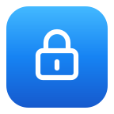

<p align="center">
  
</p>

<h1 align="center">Focus Lock</h1>

<p align="center">Set your Android phone aside for a while, or choose which apps can interrupt you.</p>

<p align="center">
  <a href="https://github.com/jichoi33/Focus-Lock/releases/latest"><strong>Download for Android</strong></a>
  &nbsp; | &nbsp; <a href="#install-and-get-started">Quick start</a>
  &nbsp; | &nbsp; <a href="#build-from-source">Build from source</a>
  &nbsp; | &nbsp; <a href="https://github.com/jichoi33/Focus-Lock/issues">Report a bug</a>
</p>

**Android 8.0+**. English interface with light and dark themes. Settings and focus history stay on your device.

## Choose a lock

| Mode | What it does | What Android needs |
| --- | --- | --- |
| **Hard Lock** | Returns the phone to the Android lock screen if you unlock it during a session. Start a timer or set a one-time or repeating schedule. | A PIN, pattern, or password and device admin access. Scheduled locks need permission for alarms and reminders. |
| **Soft Lock** | Block selected apps and websites with **Blocklist**, or keep access to just the apps you choose and essential system features with **Allowlist**. | The **Focus Lock Soft Lock** accessibility service. |

## Install and get started

1. Open the [latest release](https://github.com/jichoi33/Focus-Lock/releases/latest), expand **Assets**, and download `Focus-Lock-<version>.apk`.
2. Open the APK on your Android device. If prompted, allow the browser or file manager opening it to **Install unknown apps**.
3. Open Focus Lock, choose a mode, and follow the permission prompts. If Android blocks the Soft Lock service for a sideloaded app, open Focus Lock's Android **App info** screen and choose **Allow restricted settings** from the menu.
4. Run **Test for 1 minute** before starting a longer lock. For Hard Lock, wake the screen and expand the lock screen notification to find **End test**. For Soft Lock, **End test** is available in the app or on the block screen.

Tap **Edit** next to the timer, then scroll **Hours** and **Minutes** to set a duration. You can also tap **15 min**, **30 min**, or **1 hr**.

To update, open the latest signed APK over your existing release. Android uses the app ID and signing certificate to decide whether it can install the update in place. Enable lock screen notifications if you want to see the Hard Lock countdown and emergency controls.

## How repeating Hard Locks work

1. Choose **Every day**, **Weekdays**, **Weekends**, or **Custom**. For a custom schedule, select the days on which the lock **starts**.
2. Set the start and end times. Times follow your device’s 12-hour or 24-hour setting.
3. Tap **Save schedule** to review the first lock and final unlock time, then tap **Save schedule** again to confirm.

**Overnight example.** A Monday–Friday schedule from **22:00 to 07:00** includes Friday night through Saturday morning. Matching start and end times create a full-day window. Overlapping or back-to-back locks continue until the first gap.

## During a session

### Scheduled locks

Schedules show the time range and start days for each repeating lock. Tap an inactive schedule to edit it, or use its switch to turn it on or off. When a repeating schedule could start immediately, you can start it now or wait for the next occurrence. Daily schedules that run continuously ask for confirmation. Focus Lock schedules a reminder five minutes before a scheduled lock. Android power-saving settings can delay it.

### Emergency breaks

Emergency breaks let you pause either lock temporarily while its countdown continues. Configure the duration and number of breaks in Focus Lock settings before starting. For Hard Lock, expand the lock screen notification. For Soft Lock, tap **Emergency break** in the app or its expanded countdown notification, then confirm **Take break**. Blocking resumes automatically at the end of the break.

### Soft Lock rules

You can tighten rules or add time mid-session. Website rules include subdomains and depend on the address bar being readable in a supported browser. If the accessibility service disconnects, the app shows **Blocking paused** while the countdown continues.

### Completion and statistics

Statistics show how much time Focus Lock protected. Open Focus Lock after a regular session to see the celebration, or tap the completion notification. For Hard Lock, enable **Settings → Celebration on unlock** to open it when you unlock within 12 hours of the session ending. On Android 10 and later, allow Focus Lock to display over other apps when prompted. If Android prevents the automatic launch, the notification and app still offer the celebration. Choose **Last 7 days** to see the date range or **All time** for lifetime totals. One-minute tests are excluded from statistics.

<details>
<summary>How Android permissions affect a lock</summary>

Hard Lock reapplies the system lock screen during calls. Android handles incoming and emergency calls on that screen. An active lock can also restrict access to Android Settings.

Soft Lock reads the visible address bar in supported browsers to apply website rules. Strict mode can cover a browser if its address stays unreadable. Samsung Internet requires a verified address. Web views embedded in an allowed app follow that app’s rule. To open links in supported browser-provided tabs, turn on **Soft Lock rules → Allow in-app browser tabs** before starting. This is off by default. Opening the full browser still requires adding it to the allowlist.

If Android stops a scheduled Hard Lock from starting in the background, tap the failure notification to activate it while the scheduled window is open. The app attempts to resume active locks after reboot. Force-stopping the app, revoking permissions, changing the device clock, or manufacturer background restrictions can affect enforcement.

</details>

## Privacy

Focus Lock stores your settings, selected apps and websites, and focus statistics on your device. It reads visible browser addresses to enforce your rules and does not store or transmit the addresses you visit. The app does not request internet access.

## Build from source

Use **JDK 17 or 21** and **Android SDK 35**. Open the project in Android Studio or run the Gradle wrapper from the repository root.

```bash
./gradlew :app:assembleDebug
./gradlew :app:assembleRelease
```

On Windows, use `gradlew.bat`. APKs are generated under `app/build/outputs/apk/`. The release build produces an unsigned APK. The application ID is `com.focuslock.app.preview18`.

<details>
<summary>Verify the official release signing certificate</summary>

Run `apksigner verify --print-certs Focus-Lock.apk`, substituting the downloaded filename. Official releases from the current signing lineage use this SHA-256 certificate fingerprint.

```text
8827cf9ab561a7534f8ecc056cc61920e37cc94bd8386a21e36bd4ec6ce6a8e9
```

</details>

## License

Focus Lock is distributed under the [MIT License](LICENSE).
